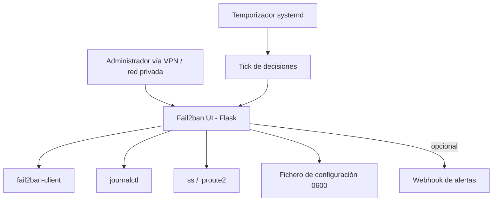

# 🛡️ fail2ban-ui-NGX — Panel web seguro para operar Fail2ban

[](https://jeturing.com)
[](https://jeturing.com)
[](LICENSE)

**Panel web autohospedado y API JSON para administrar y monitorizar Fail2ban en el host donde corre: jails e IPs bloqueadas, desbaneos, motor de decisiones configurable, enriquecimiento geográfico y de amenazas opcional, mapa mundial sin CDN y alertas por webhook. Pensado para Debian/Ubuntu con systemd, accesible solo por red privada o VPN — nunca expuesto directo a Internet.**

> 📍 **Disciplina de estado** — cada capacidad de este README lleva su estado: **Construido** (en `main`, con pruebas o evidencia) · **En desarrollo** (en una rama) · **Diseñado** (especificado, sin construir) · **Concepto** (idea registrada). Los estados nunca se mezclan.

| De un vistazo | |
|---|---|
| **Forma** | Aplicación Flask monolítica (`app.py`) que sirve el dashboard (Jinja2) y una API JSON bajo `/api/*` |
| **Estado** | Sin base de datos propia: lee los logs de Fail2ban y el estado del firewall del host; su configuración vive en un fichero con permisos 0600 |
| **Interfaces** | Dashboard web, API OpenAPI con Swagger local (sin CDN) y webhook de alertas saliente |
| **Despliegue** | `scripts/install.sh` sobre Debian/Ubuntu con systemd; servicio + temporizador del tick de decisiones |

---

## 📋 Tabla de contenido

- [🌐 Posición en el ecosistema](#️-posición-en-el-ecosistema)
- [🧩 Capacidades y estado](#️-capacidades-y-estado)
- [🏗️ Arquitectura](#️-arquitectura)
- [🗂️ Mapa del repositorio](#️-mapa-del-repositorio)
- [🔄 Flujos principales](#-flujos-principales)
- [🔒 Modelo de seguridad](#-modelo-de-seguridad)
- [🖥️ Superficies y API](#️-superficies-y-api)
- [🚀 Instalación y despliegue](#-instalación-y-despliegue)
- [⚙️ Configuración](#️-configuración)
- [🩺 Troubleshooting](#-troubleshooting)
- [🗺️ Límites honestos y roadmap](#️-límites-honestos-y-roadmap)
- [📝 Changelog](#-changelog)
- [👥 Créditos](#-créditos)

## 🌐 Posición en el ecosistema

Pertenece a **Proteger/SEGRD** (Jeturing): es la consola de operación de Fail2ban de los servidores de la casa — la superficie desde la que se vigilan los intentos de acceso y se decide qué se bloquea, sin tocar la consola del host a mano.

Qué **NO** es: no es un firewall ni un sustituto de Fail2ban (lo opera: lee su estado y ejecuta sus acciones), y no es un panel público: su entorno objetivo es red local, VPN o tailnet.

La arquitectura detallada vive en [`docs/architecture.md`](docs/architecture.md).

## 🧩 Capacidades y estado

- **Dashboard de jails y decisiones** — Construido. Estado de jails, IPs bloqueadas e intentos recientes con inventario de puertos en escucha; capturas en `docs/assets/`.
- **Acciones de escritura** — Construido, desactivadas por defecto. Desbanear y lista blanca solo si el operador las activa en la configuración.
- **Motor de decisiones** — Construido. Reglas configurables evaluadas en cada visita y por el tick periódico (`scripts/fail2ban_ui_tick.py`, temporizador systemd cada 5 minutos).
- **Alertas por webhook (Notch)** — Construido. Notificaciones salientes con modo de carga `masked` (defecto) o `full` y severidad mínima configurable; guía en [`docs/operacion/NOTCH_SETUP.md`](docs/operacion/NOTCH_SETUP.md).
- **Enriquecimiento externo** — Construido, desactivado por defecto. Geolocalización y datos de amenazas por IP (opt-in explícito, con sus llaves en la configuración).
- **Mapa mundial** — Construido. Mapa interactivo con la librería de mapas vendorizada en `static/vendor/` — sin CDN externos.
- **API y Swagger local** — Construido, opt-in. API JSON bajo `/api/*` con OpenAPI 3.0 y Swagger servido en local (sin CDN), protegido por la misma autenticación.
- **Integración con el proxy inverso** — Construido. El panel integra el estado del gestor de proxy del host (ver `docs/architecture.md`).

## 🏗️ Arquitectura



## 🗂️ Mapa del repositorio

```text
fail2ban-ui-NGX/
├── app.py                      # La aplicación completa: dashboard + API
├── templates/, static/         # Vistas Jinja2 y activos (mapa vendorizado, sin CDN)
├── scripts/                    # install.sh y el tick de decisiones
├── SECURITY.md                 # Política de seguridad del panel
└── docs/                       # Documentación completa — índice en docs/README.md
```

La documentación completa vive en [`docs/`](docs/README.md), indexada por tema.

## 🔄 Flujos principales

### Puesta en marcha

1. `scripts/install.sh` instala el servicio; al final imprime la URL de configuración con su token (`/setup?token=…`, solo alcanzable en local o por red privada/VPN).
2. El asistente crea el usuario administrador (contraseña mínima de 12 caracteres), fija panel, servidor, puerto y las jails a monitorizar.
3. Las funciones opcionales (diario, inventario de puertos, escritura, API, Swagger, enriquecimiento, enlaces externos, enmascarado de IPs) se activan una a una; nada viene encendido por defecto.

### Tick de decisiones

1. El temporizador systemd ejecuta el tick cada 5 minutos.
2. El motor evalúa las reglas configuradas sobre el estado actual de Fail2ban.
3. Si hay decisiones que notificar y el webhook está activo, sale la alerta con la carga enmascarada por defecto.

## 🔒 Modelo de seguridad

| Control | Estado por defecto |
|---|---|
| Autenticación básica | Exigida tras la configuración inicial |
| Contraseñas | PBKDF2-SHA256 con sal (240k iteraciones) |
| Fichero de configuración | Permisos 0600 |
| CDN / mapas externos | Desactivados (activos vendorizados) |
| Enriquecimiento externo | Desactivado hasta activarlo y darle llaves |
| Acciones de escritura | Desactivadas |
| Swagger | Opt-in, protegido por la misma autenticación |
| Setup sin token | Solo desde loopback, red privada o tailnet |
| Setup con token | Variable de entorno del token de setup |

La política completa está en [`SECURITY.md`](SECURITY.md). El panel **no se expone directo a Internet**: se accede por localhost, túnel SSH, VPN o tailnet.

## 🖥️ Superficies y API

- Dashboard web (jails, intentos, puertos, mapa) y asistente de configuración inicial.
- API JSON bajo `/api/*` con contrato OpenAPI 3.0 y Swagger local opt-in.
- Webhook saliente de alertas (configuración en [`docs/operacion/NOTCH_SETUP.md`](docs/operacion/NOTCH_SETUP.md)).

## 🚀 Instalación y despliegue

### Requisitos

- Debian/Ubuntu con systemd y Fail2ban instalado; Python 3.11+ (dependencias en `requirements.txt`).

### Instalar

```bash
git clone https://github.com/jeturing/fail2ban-ui-NGX.git
cd fail2ban-ui-NGX
sudo bash scripts/install.sh
```

Al terminar, el instalador imprime la URL de configuración con token en el puerto local del panel. Validado el 2026-05-28.

## ⚙️ Configuración

| Parámetro | Dónde vive | Notas |
|---|---|---|
| Configuración del panel | Fichero de configuración del servicio (0600) | Se edita desde el asistente/Ajustes; cambiar host o puerto exige reiniciar el servicio |
| Token de setup | Variable de entorno del servicio | Solo para la configuración inicial |
| Llaves de enriquecimiento | Ajustes → API Keys | Solo si el enriquecimiento está activado |

## 🩺 Troubleshooting

### Cambié el puerto y el panel no responde

Causa: los cambios de host/puerto de escucha requieren reinicio. Corrección: `sudo systemctl restart fail2ban-ui` y verificar que el acceso sigue siendo solo por red privada.

### El panel no muestra una jail

Causa: la jail no está entre las monitorizadas en la configuración. Corrección: añadirla en Ajustes (las habituales de la casa: `sshd`, `portscan`, `sensible-ports`, `recidive-48h`, `blacklist-permanent`).

## 🗺️ Límites honestos y roadmap

- `deploy-config.env` era una instantánea de la configuración de un despliegue concreto versionada en la raíz: fue purgada de todo el historial el 2026-11-17 por contener valores de autenticación, y sus valores deben rotarse y no reutilizarse en otro host.
- Monolito de un solo fichero a propósito: no hay paquetes ni base de datos que migrar; el estado es el del host.

## 📝 Changelog

### 2026-10-02 — Pasada de calidad (`3d2e94f`)

- Auto-corrección de formato y lint sobre la línea validada el 2026-05-28.

## 👥 Créditos

**Jeturing Inc.** — frente SEGRD (Proteger). Licencia GPL-3.0 (ver `LICENSE`).
